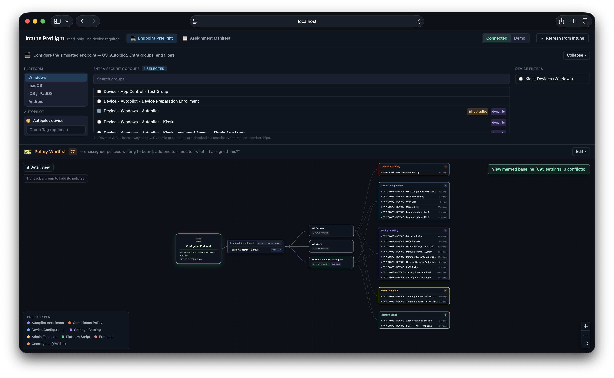

# Intune Preflight

**Validate Intune policies & assignment logic before your devices ever take off.**

Intune makes you click into every Configuration Profile, Compliance Policy, Settings Catalog policy, and Administrative Template one at a time to work out what actually lands on a device. Intune Preflight connects to your tenant, reads every policy and its assignments, and lets you **simulate an endpoint** — pick an OS, the Entra groups it belongs to, its Autopilot Group Tag, and any Assignment Filters it matches — then computes the full merged CSP-level baseline that endpoint would receive. No hardware, no enrollment, no Policy Sets.

**Open it and sign in. That is the whole setup.** There is nothing to install, no container to run and no server to deploy, because there isn't one: the page is the only thing you download, and your tenant's configuration goes from Microsoft Graph straight into your browser tab and nowhere else. No client secret is ever created, since a single-page app can't hold one. Every permission it asks for ends in `.Read.All`, so it cannot change anything in your tenant.

Prefer to run it on your own infrastructure? It **self-hosts** exactly as it always has, with application credentials in your own `.env`. That mode sees the entire tenant unfiltered, which a signed-in admin does not. Same code, same engine, your choice.



_Pick an OS and the Entra groups an endpoint belongs to, and see exactly which policies apply as a connected diagram: endpoint → Autopilot → groups → policies._

## Try it now

**▶️ [Open Intune Preflight](https://kevinmalinoski.github.io/intune-preflight/app/)** — sign in with your own admin account to read your tenant, or explore the bundled sample tenant with no sign-in at all. Best on a desktop-sized screen.

Connecting your own tenant takes one PowerShell script and about three minutes: **[walkthrough →](https://kevinmalinoski.github.io/intune-preflight/connect/)**

There is also a **[sign-in-free demo](https://kevinmalinoski.github.io/intune-preflight/demo/)** over the same sample tenant, if you want to send someone a link with nothing to decide.

### Or run it on your own machine

No tenant and no app registration required — it ships with a **bundled sample tenant**. Clone the repo, or download the [latest release](https://github.com/kevinmalinoski/intune-preflight/releases/latest):

```bash
npm install
npm run dev        # server :4000, web :5173 — open http://localhost:5173
```

With no `.env` present it starts in **Demo** mode against synthetic data that exercises every feature: a conflict, an overlap, an exclude-wins case, an All Devices + include-filter case, dynamic Group Tag implication, an unassigned policy, and Autopilot V1 + V2. A **Demo / Connected** toggle in the header flips between the sample data and your real tenant — **Connected** unlocks once you add a `.env`.

## Three ways to run it

All three run the **same engine** — `packages/engine` is pure and I/O-free, and the public demo is the proof that it runs unchanged in a browser. What differs is only where the tenant data comes from.

| | Demo | **Browser** | Self-hosted |
|---|---|---|---|
| **Setup** | none | one app registration, ~3 min | app registration + `.env` + Docker/npm |
| **Auth** | none | **you sign in** (delegated, PKCE) | app-only client secret |
| **Client secret** | — | **none exists** | yes, you manage it |
| **Runs on** | your browser | your browser | your server |
| **Sees** | bundled sample tenant | the tenant, as scoped to **your** Intune RBAC | the **entire** tenant, unfiltered |
| **Data at rest** | — | nothing; dies with the tab | in-memory cache on your server |

The row that decides it for most people is **Sees**. Browser mode signs you in as yourself, so it reads exactly what you could already read: if your Intune role carries scope tags, the preflight carries them too. For an unscoped admin that is the whole tenant and the two modes agree. For a scoped one, only app-only returns the complete picture — which is the reason self-hosting still exists rather than a leftover from before.

Self-hosting is also the answer when Conditional Access won't issue a token to a single-page app. Nothing about it changed in 2.2: same `.env`, same Docker images, same behaviour.

➡️ **[Connect your tenant — three-minute walkthrough](https://kevinmalinoski.github.io/intune-preflight/connect/)** · **[Full setup guide — app registration, browser mode, config, Docker](docs/SETUP.md)**

There is also a **browser mode**: a static build with no backend, where an admin signs in with their own account and the page reads the tenant directly from Graph with delegated, read-only permissions and no client secret. ➡️ **[Browser mode setup](docs/SETUP.md#browser-mode--sign-in-as-yourself-no-backend)**

## Why preflight?

The normal loop is deploy-and-pray: assign a policy, wait for devices to check in, watch for failures and conflicts, dig into which policy actually won, fix it, then wait a few more days for the next check-in to confirm. **Intune Preflight collapses that loop** — simulate the endpoint up front and see its full merged baseline, conflicts, overlaps, and exclusions *before* you deploy.

**This is an admin tool that deliberately sees everything.** It authenticates with tenant-wide, read-only *application* permissions, so it returns the **complete, unfiltered** picture of every policy and assignment. Unlike the Intune console for a scoped admin, it is **not** filtered by RBAC scope tags or admin-unit boundaries — that's intentional. A meaningful preflight needs the whole tenant's configuration, not one admin's slice of it.

## What it does

- 🛫 **Endpoint simulator** — device → Autopilot → groups → policies as a live diagram, with a merged CSP baseline behind it.
- 🏷️ **Autopilot aware** — Group Tag simulation, plus **V1 deployment profiles and V2 device-preparation** policies shown as an enrollment stage (including dual-targeting).
- 🎯 **Assignment Filter simulation** — toggle the filters a device matches and watch every policy re-resolve; include and exclude filters are handled as the opposites they are.
- 🎫 **Policy Waitlist** — pull an *unassigned* policy into the simulation to preview "what if I assigned this?"
- 🔍 **Merged baseline drill-down** — every setting from every applied policy in one filterable grid, with the real **CSP path** and a **Microsoft Learn** link per setting.
- ⚔️ **Conflicts, overlaps & cross-model collisions** — genuine value disagreements vs redundant duplicates, surfaced separately (Windows) — plus **"legacy policy collisions"**: the same CSP configured through *different* policy models (a legacy template *and* a Settings Catalog policy) that per-model detection can't see, with a migrate-to-Settings-Catalog nudge.
- 🛡️ **Legacy Endpoint Security & template flags** — intents-based BitLocker, Defender Antivirus, Firewall and ASR policies read and merged with their **real names, value labels and doc links**; deprecated device-config **templates are flagged for migration** to the Settings Catalog.
- 🏷️ **Group Tag transparency** — dynamic groups are classified against the entered Group Tag (confident match, *+ conditions*, or *conditional*) with each group's `[OrderID]` scope shown inline — surfaced honestly rather than pretending to be Entra's evaluator.
- 📋 **Assignment Manifest** — a tenant-wide map of which groups carry which policies, with filter simulation and Excel/CSV export.
- 🔗 **Manifest ↔ Simulator** — check groups in the Manifest and *simulate a device in exactly those groups*; per-group **"seating charts"** reveal at a glance whether a group's policies are its own or shared across the tenant.
- 🌐 **Four platforms** — Windows, macOS, iOS/iPadOS, and Android, scoped separately.
- 📤 **Export** — an Excel workbook (`.xlsx`), CSV or JSON from the simulator, workbook or CSV from the Manifest. The workbook is the one mobile Excel will open.

➡️ **[Full feature walkthrough with screenshots](docs/FEATURES.md)**

## What's included in the baseline

**Covered:** Device Configuration profiles (all platforms, incl. Apple/Android Wi-Fi, VPN, certs, custom) · Settings Catalog — **including Security Baselines and Endpoint Security policies** (Antivirus, Disk Encryption, etc.) now delivered through the unified settings platform · **legacy Endpoint Security & Security Baselines** still stored as `deviceManagement/intents` (legacy BitLocker / Disk Encryption, Defender Antivirus, Firewall, ASR, …) · Compliance policies · Administrative Templates (ADMX) · Platform Scripts (Windows PowerShell + macOS shell) · Windows Feature / Quality / Driver Update profiles.

**Intentionally excluded:** Proactive Remediations, enrollment-time policies (ESP / enrollment restrictions), and app-level MAM / app configuration.

**On user targeting:** policies assigned to Entra **user groups are resolved** — user groups are selectable like any other group, and the **All Users** virtual group always applies. What's out of scope is modelling a **specific user identity**: the tool never evaluates whether a named user belongs to a group, so nothing is inferred from who signs in. (That's also why Autopilot V2 resolves by its configured device group rather than its user assignment — see [FEATURES.md](docs/FEATURES.md#autopilot-profile-associations-v1--v2).)

## Known limitations

Honest edges in v2 — none block the core use, but know them before you rely on a result:

- **Dynamic membership is surfaced, not fully evaluated.** Group Tag / Autopilot auto-selection reads the `[OrderID]` and `[ZTDId]` clauses in `device.devicePhysicalIds` (`-eq` / `-startsWith`); a confident match is auto-selected. When a rule *also* hinges on a property a tag can't decide (`deviceOSType`, `deviceCategory`, …), the group is flagged **+ conditions** with its rule shown, and a tag that's merely referenced is flagged **conditional** (not auto-selected) — so the edge is visible per group rather than guessed. A real membership-rule engine is a post-2.0 accuracy upgrade.
- **Conflict & overlap detection is Windows-only.** Other platforms don't map cleanly onto value-level comparison yet. The **merged baseline itself is still shown on every platform** — only the conflict/overlap flags are Windows-scoped.
- **Cross-model collision detection is best-effort.** Settings Catalog ↔ OMA-URI is exact (shared CSP path); the legacy-template → CSP crosswalk is a small, hand-verified set, and legacy Endpoint Security intents aren't crosswalked yet — so it checks *common* cross-model settings, not every one. Migrating legacy templates to the Settings Catalog is the real fix, which the "Legacy template" flag encourages.
- **Settings flattening is schema-agnostic** — derived from each Graph resource's own properties rather than a hand-maintained CSP schema, so raw Graph field names can show up as setting names in some cases (legacy intents now resolve real names/values from their template definitions).
- **Tested against sandbox Microsoft 365 tenants.** Always verify against the Intune admin center before relying on a computed baseline for compliance decisions.
- **A conflicted setting has no computed winner.** The merged baseline shows one row per setting; where applied policies disagree, the UI and CSV expand every value rather than picking one, and the API marks the row `conflicted`. Deciding which value wins on the device is left to Intune — deliberately. See [reading a conflicted setting](docs/SETUP.md#reading-a-conflicted-setting-from-the-api).

➡️ **[Full limitations, v2 maintenance and v3 bets — ROADMAP.md](ROADMAP.md)**

## Security

Read this before you host it anywhere other than your own machine:

- **The self-hosted server has no built-in authentication.** This applies to the `apps/server` build only, and it has not changed: there is no login and API callers are not authenticated, so anyone who can reach the web UI or API port can read the policy data it surfaces. Browser mode is a different build with a different security model — see below — and the existence of sign-in *there* changes nothing about the server.
- **The self-hosted server listens on all interfaces** (`0.0.0.0`). Combined with the point above: **run it on localhost or a trusted private network, and never expose it directly to the internet** without putting your own authentication in front of it. Browser mode is the build that is designed to be hosted publicly; the server is not.
- **Read-only.** Every Graph permission is `*.Read.All`; the tool never writes to your tenant.
- **Credentials stay server-side.** `TENANT_ID` / `CLIENT_ID` / `CLIENT_SECRET` live only in the server's `.env`, are never sent to the browser, and `.env` is gitignored.
- **Browser mode has no secret at all.** The static build is a public client using PKCE: the tenant and client IDs it stores in the browser are not secrets, the access token lives in `sessionStorage` and dies with the tab, and the permissions are delegated — bounded by what the signed-in admin can already read.
- **Full-tenant visibility by design.** App-only permissions mean it sees the *entire* tenant's configuration, unfiltered by scope tags or admin units. That's intended — but it makes the app registration effectively a tenant-wide read key. Protect it, grant only the permissions listed in the setup guide, and rotate the secret periodically.

## Documentation

| Doc | What's in it |
|---|---|
| **[docs/FEATURES.md](docs/FEATURES.md)** | Full walkthrough of the simulator and the Assignment Manifest, with screenshots |
| **[docs/SETUP.md](docs/SETUP.md)** | Entra app registration, permissions, `.env`, Docker / npm, API reference, troubleshooting |
| **[ROADMAP.md](ROADMAP.md)** | Known limitations in detail, remaining v2 maintenance, and the v3 bets |
| **[CHANGELOG.md](CHANGELOG.md)** | Release history |

## Acknowledgments

Designed and built by Kevin Malinoski, pair-programmed with [Claude Code](https://claude.com/claude-code) (Anthropic). AI-assisted commits carry a `Co-Authored-By` trailer in the Git history.

## Disclaimer

Intune Preflight is an independent, community-built tool. It is **not affiliated with, endorsed by, or sponsored by Microsoft**. Microsoft, Intune, and Entra are trademarks of the Microsoft group of companies, used here only to describe what the tool works with.

## License

MIT — see [LICENSE](LICENSE).
