# Features

A walkthrough of what Intune Preflight does. Two tabs: the **Endpoint Preflight** simulator (what would *this device* get — its settings and, new in v3, its apps) and the **Assignment Manifest** (which groups carry which policies, tenant-wide).

> Everything here is read-only. The tool never writes to your tenant.

- [Endpoint Preflight — the simulator](#endpoint-preflight--the-simulator)
  - [Apps for this endpoint](#apps-for-this-endpoint) _(new in v3)_
- [Assignment Manifest](#assignment-manifest)

---

# Endpoint Preflight — the simulator

Describe an endpoint, and the tool resolves every policy that would land on it — the way Intune resolves it, including excludes, filters, and inheritance.

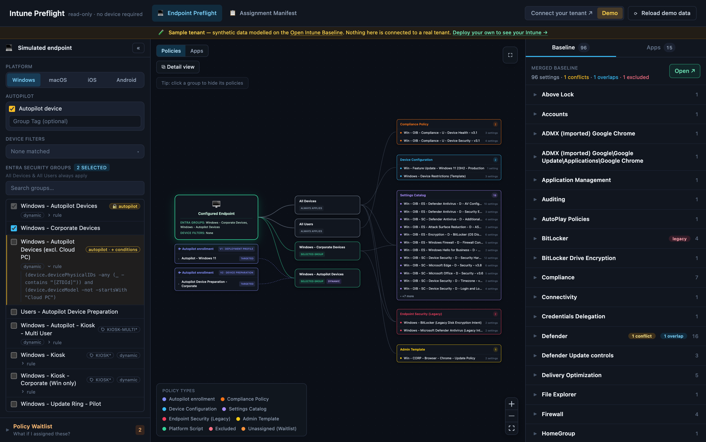

_The full flow: configured endpoint → Autopilot enrollment → Entra groups → the policies each group brings._

**The screen is three columns, in the order you use them.**

| Column | What it is |
|---|---|
| **Simulated endpoint** (left) | The inputs: OS, Autopilot and Group Tag, device filters, the Entra groups, and the Policy Waitlist. It scrolls on its own and collapses to a strip with **«** when you want the width. |
| **The diagram** (middle) | How the endpoint resolves. It always has the full height — nothing you open on the left resizes it. A **Policies / Apps** switch chooses what it draws. |
| **Results** (right) | What the endpoint gets: the **Baseline** tab (merged settings) and the **Apps** tab. Switching tabs switches the diagram with it. |

On a phone-width screen the left column becomes a one-line summary of the endpoint with an **Edit** button, and the results open as panels over the diagram.

## Entra group assignment

Pick the Entra security groups the endpoint is associated with. Policies resolve live as you select — you see the merged result immediately, not after a device check-in.

**Device *and* user groups are both resolved.** Any Entra group referenced by an assignment is selectable, so a policy targeted at a user group resolves exactly like one targeted at a device group. The tool doesn't model a specific user identity (it never evaluates whether a named user is in a group) — you tell it which groups are in play, and it does the assignment math from there.

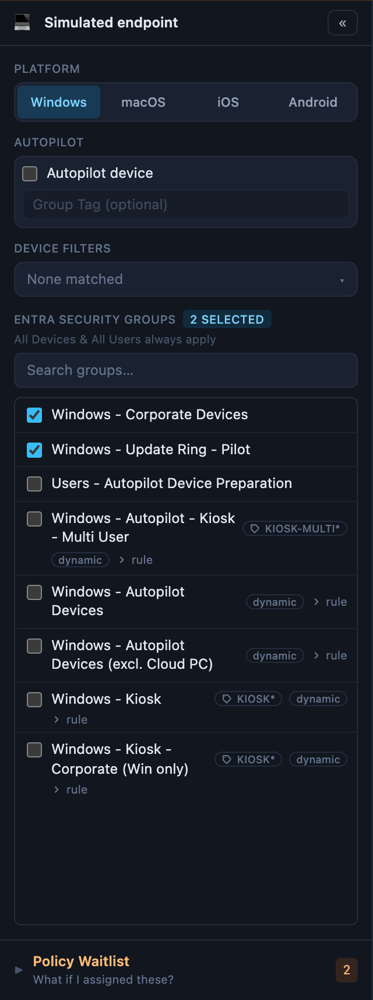

_The endpoint sidebar. Search and tick the groups an endpoint belongs to; selected groups rise to the top. **All Devices** and **All Users** always apply and are added automatically. Each dynamic group's membership rule is one click away under **rule**._

Three things happen automatically:

- **All Devices / All Users** are always in play — every device inherits them, so they're always shown.
- **Exclude wins.** If any selected group is excluded from a policy, that policy is dropped from the applied set and shown as an exclude — never silently omitted, and never wrongly counted as applied.
- **Implied groups.** Selecting a dynamic group whose rule logically *guarantees* membership in a broader one adds that group too, flagged **"Implied by rule"** so you can eyeball it against Entra. This is deliberately narrow: it only fires between rules built **solely** from `devicePhysicalIds` clauses — a narrower Group Tag prefix implying a broader one (`SALES-KIOSK-MULTI` ⇒ `SALES-KIOSK`), or any Autopilot-tagged group implying a bare `[ZTDId]` group. The moment a rule mixes in another condition (ownership, OS type, device model), membership depends on something the tool can't evaluate, so **no implication is claimed** — two rules merely *sharing* a condition are not related.

## Autopilot Group Tag simulation (V1)

Flag the endpoint as an Autopilot device and enter its **Group Tag**. Each dynamic group is classified against the tag and the list re-sorts so the relevant ones rise to the top (selected → matches → conditional → rest), with each group's `[OrderID]` scope shown inline (e.g. `KIOSK*`) and matches fading in.

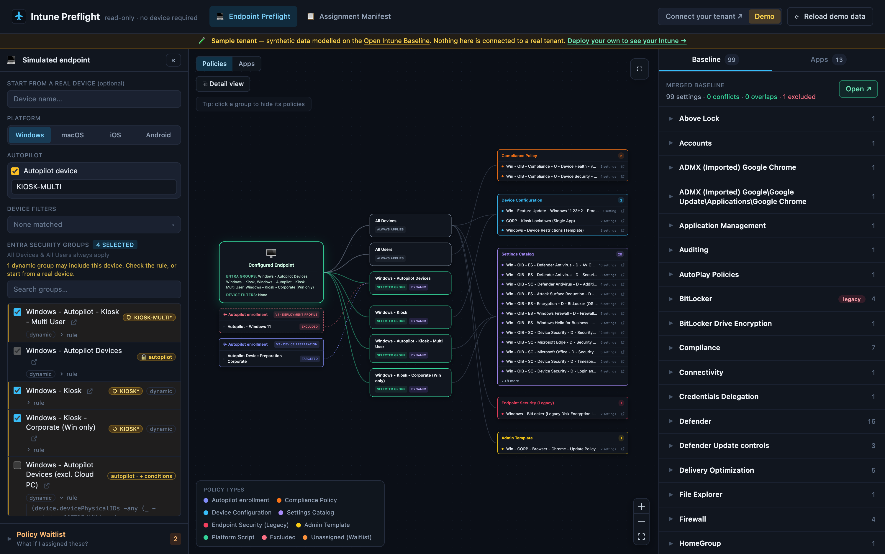

_Set the Group Tag and the matching dynamic groups float to the top and select themselves, each badged so you can verify it._

**Three match states — surfaced, not guessed:**

- **`group tag`** — the rule's `[OrderID]` clause confidently matches the tag, and nothing else in the rule needs evaluating. **Auto-selected.**
- **`+ conditions`** — the tag matches, but the rule *also* hinges on a property a Group Tag can't decide (`deviceOSType`, `deviceCategory`, enrollment profile, …). Still auto-selected (as before), but flagged with the **full membership rule shown** so you can verify the rest.
- **`conditional`** — the tag is referenced but the flat evaluator can't confirm the combined rule (e.g. two ANDed `[OrderID]` tags). **Surfaced but not auto-selected** — review the rule and tick it if it applies.

> **Why not a full evaluator?** Auto-selection reads the `[OrderID]` (Group Tag) and `[ZTDId]` (Autopilot-joined) clauses in `device.devicePhysicalIds` (`-eq` / `-startsWith`, plus `-contains` for `[ZTDId]`). Other device properties can't be evaluated from a Group Tag alone, so rather than pretend to be Entra's membership engine, the tool **shows the rule and the match state** and lets you judge. A real membership-rule evaluator is a planned accuracy upgrade — see [ROADMAP.md](../ROADMAP.md).

**`or` is handled correctly, with operator precedence.** A bare `[ZTDId]` clause is satisfied by *every* Autopilot-registered device, so whenever it stands as a top-level `or` branch the group is selected — any satisfied branch grants membership. Entra applies standard precedence (`and` binds tighter than `or`), so this very common real-tenant shape resolves as `(ownership and trust and appId and osType) or (ZTDId)` — and an Autopilot device is a member via that last branch regardless of the `and` chain:

```
(device.deviceOwnership -eq "Company") and (device.deviceTrustType -eq "AzureAD")
  and (device.deviceManagementAppId -contains "0000") and (device.deviceOSType -eq "Windows")
  or (device.devicePhysicalIDs -any (_ -contains "[ZTDId]"))
```

An `and` **inside the ZTDId branch itself** is the opposite case — membership would also depend on a condition this evaluator can't check, so the group is left for manual selection rather than risking a false positive:

```
(device.devicePhysicalIDs -any (_ -contains "[ZTDId]"))
  and (device.deviceModel -not -startsWith "Cloud PC")     ← not auto-selected
```

A `[ZTDId]` pinned to a specific device (`"[ZTDId]:<guid>"`) doesn't count as "any Autopilot device" either.

## Assignment Filter simulation

Choose which Intune Assignment Filters the simulated device matches. Policies scoped by a filter re-resolve accordingly — and the two filter directions are treated as the opposites they are:

| Filter type | Drops the policy when… | Reads as |
|---|---|---|
| **Exclude** | the device **matches** the filter | "this device matches *Kiosk Devices*, which this policy excludes" |
| **Include** | the device **does not match** the filter | "only applies to devices matching *VPN-Eligible*, this device doesn't" |

That distinction matters: an **All Devices assignment with an include filter** looks like it applies to everything, but actually only targets the filtered subset — the tool says so explicitly instead of just reporting "excluded."

## Collapsed vs. Detail view

The diagram groups policies by type by default, so a 150-policy tenant stays readable. Toggle **Detail view** to expand every policy into its own node.

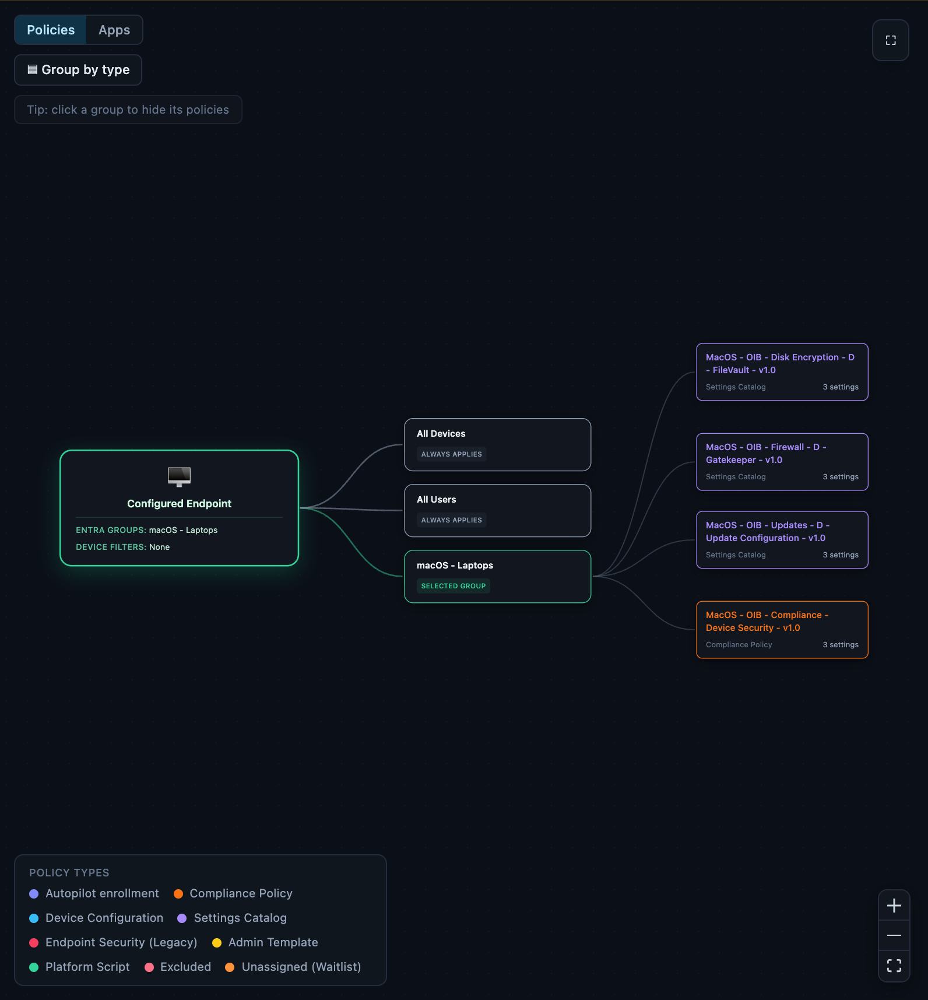

_Detail view — every applied policy as its own node, coloured by type. Excluded policies are drawn dashed in red._

## Hide a group's policies

Click any Entra group in the diagram to hide the policies it contributes. Useful for isolating what a *single* group is responsible for when several overlap.

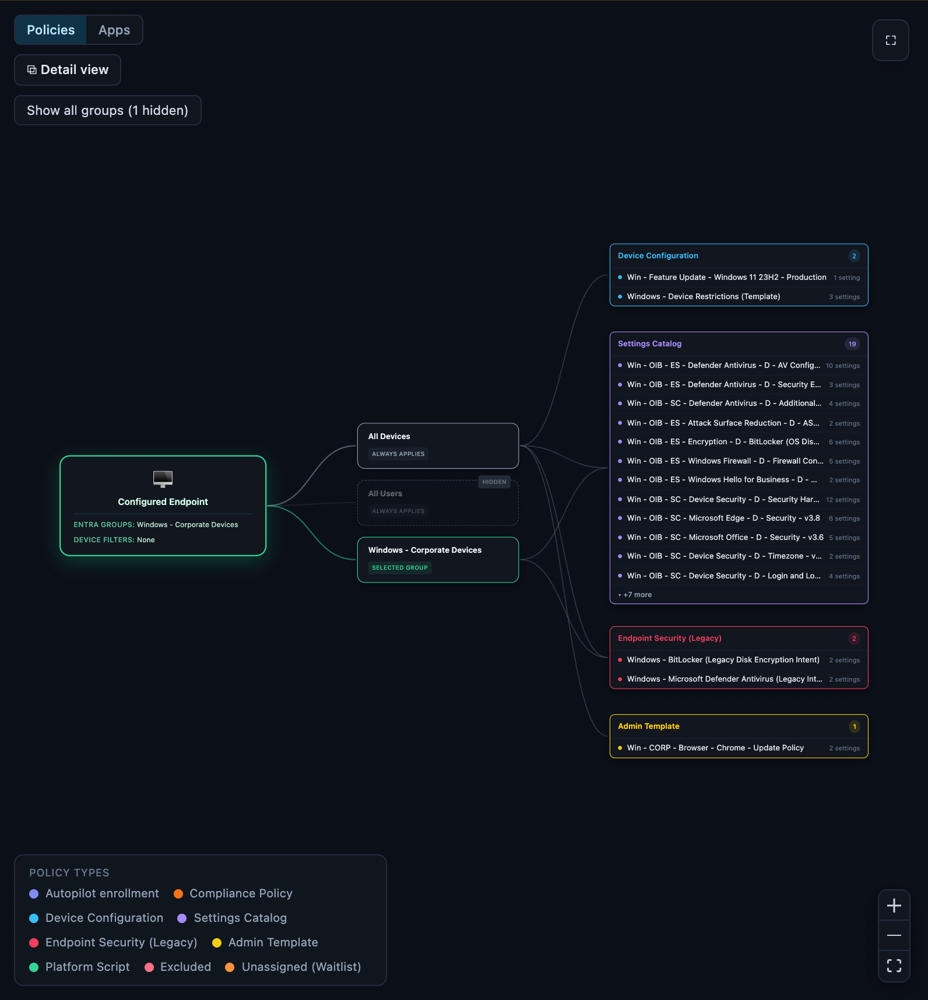

_Click a group to fold away its policies; click again to bring them back._

## Policy Waitlist — "what if I assigned this?"

Policies that exist in your tenant but are assigned to **nothing** never show up in a normal simulation. The **Policy Waitlist** — the last section of the endpoint sidebar, since it is one more input to the endpoint — lists them and lets you pull any of them into the simulation to preview the impact before you ever create the assignment.

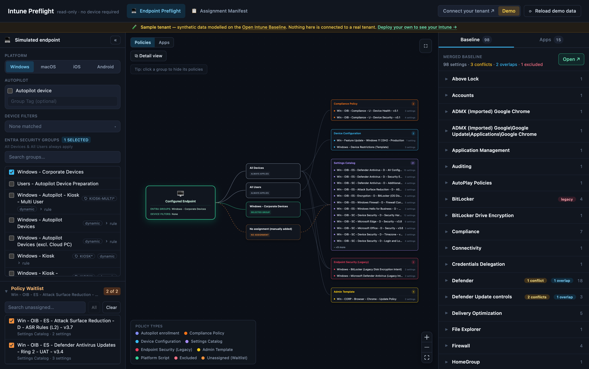

_Unassigned policies waiting to board, at the foot of the sidebar. Tick one — or **All** — and it joins the diagram on a dashed orange "No assignment" line, and its settings join the baseline._

## Merged baseline & policy drill-down

The heart of the tool: every CSP setting from every applied policy, merged. The **Baseline** tab beside the diagram shows it by CSP area, with conflicts and overlaps badged on each area, so you watch it change as you tick groups. **Open ↗** expands it into the full filterable grid.

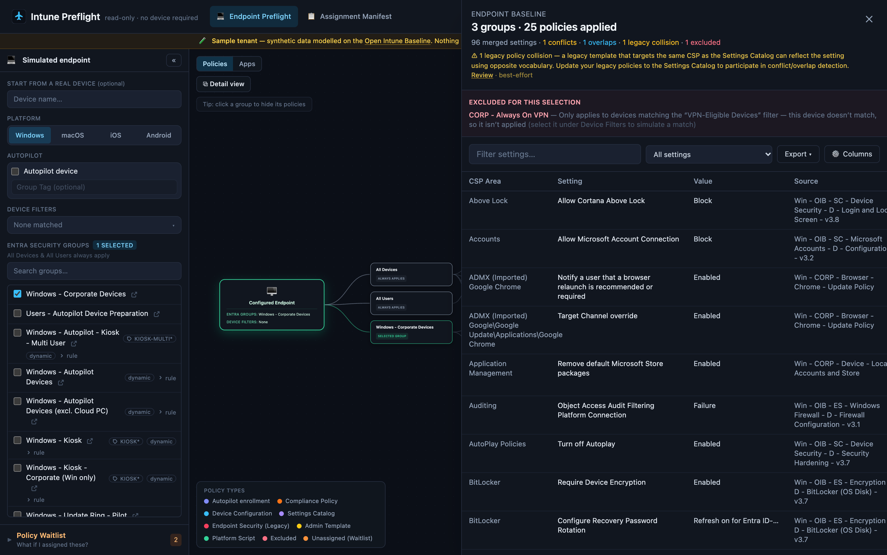

_Every setting from every applied policy, merged, filterable, and traceable back to its source policy._

- **Drill down from anywhere** — click a policy type bubble or an individual policy in the diagram to open the baseline scoped to it.
- **Resizable columns and a column picker** — show and hide columns Intune-style; your layout persists.
- **Source tracing** — every setting shows which policy set it.
- **Human-readable names and values** — Settings Catalog settings resolve to their real display names and option labels (e.g. "Enabled") rather than raw definition IDs.
- **Export** — an Excel workbook, CSV or JSON of the full merged baseline, from one **Export ▾** menu.

## CSP paths & OMA-URIs

Each setting carries its real **CSP path** (e.g. `./Device/Vendor/MSFT/BitLocker/RequireDeviceEncryption`) plus a direct **Microsoft Learn** documentation link, so you can jump from "this setting applies" to "here's what it actually does."

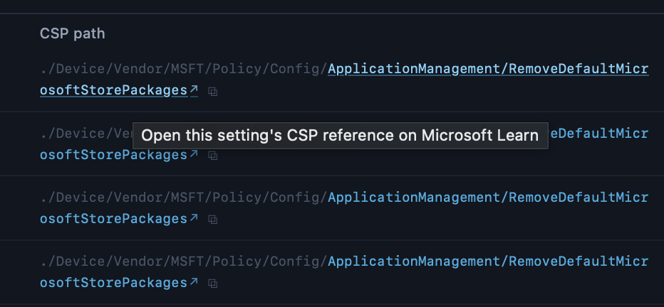

_The CSP path column, with a per-setting link to the Microsoft Learn documentation for that CSP._

**Windows Custom (OMA-URI) profiles** are handled as first-class settings: each `omaSettings` entry is keyed on its OMA-URI, so two custom profiles writing the same URI are correctly detected as a genuine conflict or overlap — not treated as unrelated.

## Policy overlap & conflict detection (Windows)

When two applied policies touch the same setting, the tool distinguishes:

- **Conflict** — same setting, **different** values. A real disagreement Intune will resolve silently; you want to know.
- **Overlap** — same setting, **same** value. Not a problem, but redundant configuration worth cleaning up.

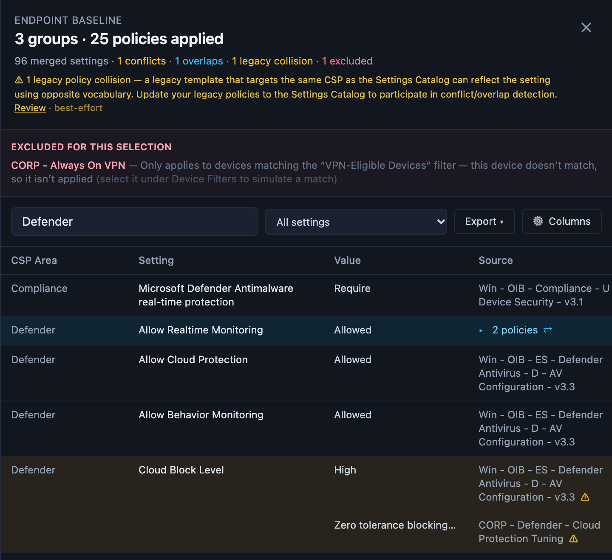

_Genuine conflicts and redundant overlaps, surfaced separately with every contributing policy._

### Legacy policy collisions (cross-model)

Native conflict/overlap detection keys each setting on an id derived from its policy **model**, and the models don't share an id space — so the same underlying CSP configured through a **legacy device-config template** *and* a **Settings Catalog** policy (or an OMA-URI custom profile) slips past it entirely, reporting `0 conflicts` even though the device gets both. This is common mid-migration.

The tool catches these separately as **legacy policy collisions**: each setting resolves a canonical `cspNode` — exact for Settings Catalog and OMA-URI (they carry a real CSP path), and via a curated, Microsoft-docs-grounded **template → CSP crosswalk** for legacy templates — and any CSP touched by two different models is surfaced as a **duplicate** (same value), **conflict** (different), or **verify** (values that can't be compared). A count sits next to conflicts/overlaps, a **Legacy collisions** filter lists them, and a one-line disclaimer nudges migrating the legacy template to the Settings Catalog (the real fix). It's **best-effort over common settings** — the crosswalk is a hand-verified set, not every CSP.

> **Windows only.** Value-level comparison isn't trustworthy on other platforms yet — macOS `.mobileconfig` profiles share metadata that reads as false overlaps, and the common one-concern-per-macOS-compliance-policy pattern produces false conflicts. Both flags (and cross-model collisions) are therefore suppressed off Windows. **The merged baseline itself still renders on every platform** — only the conflict/overlap flags are Windows-scoped. See [ROADMAP.md](../ROADMAP.md).

## Autopilot profile associations (V1 & V2)

Autopilot appears as an **enrollment stage** under the endpoint card, showing which deployment profile the device would enroll through.

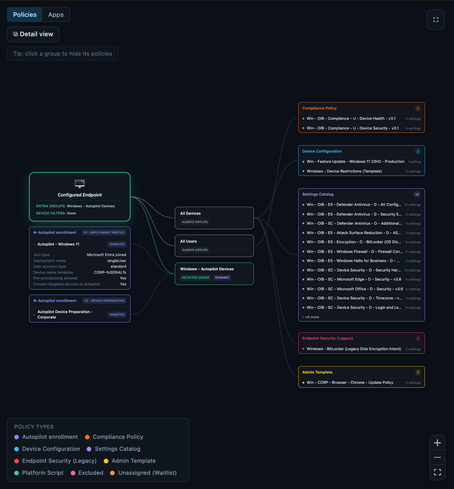

_Autopilot V1 deployment profiles and V2 device-preparation policies, with the groups they target. Cards are collapsed by default — click to expand the deployment settings._

Two kinds of line meet at a group, because they are two different relations. A **solid** line from the endpoint card means the device is a *member* of that group. A **dotted** line from an Autopilot card, leaving from the profile's name, means that profile is *assigned* to that group. A profile that is assigned but excluded draws its line dashed in red, like every other exclusion.

- **V1** — `windowsAutopilotDeploymentProfiles`, targeted by device group. Exclusions are evaluated.
- **V2** — Windows Autopilot **device preparation** policies. Targeting keys on the policy's **configured just-in-time device group**, not its user assignment.
- **Dual targeting is detected** — when a V1 and a V2 profile both target the same device group (common where V1 retroactively enrolls after a V2 rollout), both are shown so you can see the overlap.
- Cards are **collapsed by default**; expand for join type, deployment mode, account type, device name template, and the rest.

> **ℹ️ Why V2 resolves by device group.**
> Autopilot V2 is a user-driven experience, but this tool doesn't model a **specific user identity** — it never evaluates whether a named user belongs to a group, so nothing can be inferred from who signs in. V2 is therefore resolved by its **configured just-in-time device group**, which keeps the result deterministic for a device-centric simulation.
>
> To be clear: **user-group assignments are still resolved everywhere else.** Entra user groups are selectable like any other group, the **All Users** virtual group always applies, and both are counted in the Assignment Manifest. What's absent is inferring membership from a sign-in.
>
> We understand this isn't full V2 logic. It's included because the deployment context genuinely helps you understand and validate an Intune configuration. **Richer user / user-group modelling is on the roadmap** — see [ROADMAP.md](../ROADMAP.md).

## Apps for this endpoint

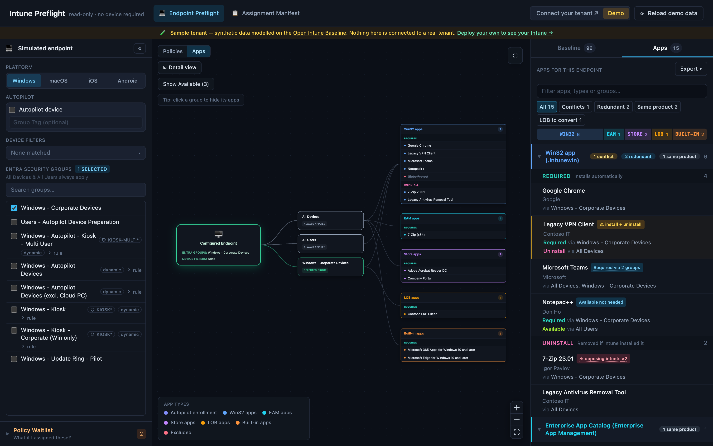

_The same endpoint, switched to **Apps**: one bubble per app type in the diagram, and the list grouped the same way, with findings badged on each type._

The same groups that deliver a device's policies deliver its apps, so the simulator resolves those too. The rail beside the diagram has an **Apps** tab next to the baseline, and the diagram follows it: on **Baseline** it draws the endpoint's policies, on **Apps** it draws its apps instead. It is one or the other, never both, so neither view shrinks to make room for the other; a **Policies / Apps** switch on the canvas does the same thing where there is no rail (phone widths and focus mode).

Apps are laid out the way the baseline is. The list is an accordion **grouped by app type** — Win32, Enterprise App Catalog, Store, line-of-business, and so on — with the findings badged on each type's header, and inside each type the apps are sectioned **Required**, **Uninstall** and **Available**. Microsoft 365 Apps, Microsoft Edge and Microsoft Defender — the apps Intune has its own type for — share one **Built-in** group. The diagram matches: one bubble per app type, sectioned the same way, with edges from the groups that deliver them. Click a bubble, or an app in it, to open that type in the list.

Each app object is listed **once**, in the list and in the diagram, showing its publisher and the groups it arrives through — an app that lands under two intents lists both on that one row. Two *different* objects for one product (a Store app and a Win32 package of the same title) stay separate, because they are different payloads; that is what the same-product finding is for.

**Available apps are hidden by default.** An offer in Company Portal changes nothing on the device until a user takes it up, so the space goes to what will be installed and what will be removed. The **Available apps** section at the bottom of the list (and **Show Available** on the canvas) brings them back, and a search or a finding view always includes them. Assignment resolution is the same as for policies: include and exclude groups, All Devices / All Users, and Assignment Filters, so toggling a device filter re-resolves apps along with everything else. Apps a group assigns but an exclusion or filter carves out are listed under **Doesn't land**, with the reason.

Apps are deliberately **not** rows in the merged baseline. The baseline is settings, compared by value; an app has neither, so it gets a surface of its own.

### App types at a glance

Above the list, a **type mix** bar shows the proportions of each app type. Each segment is a button: click one to narrow the list to that type, and click it again to come back.

### App assignment findings

The aim is one product, on the device once, under one intent. Three findings flag where that isn't so, each the counterpart of a baseline finding. **Every alert is a button**: click "Available not needed" or "opposing intents ×4" on an app and the list narrows to that finding — for a same-product alert, to exactly the apps that overlap, side by side with their intents and groups. The row of finding buttons above the list (**All · Conflicts · Redundant · Same product**) does the same from the top, and shows a clean result in green.

| Finding | Baseline counterpart | What it means |
|---|---|---|
| **Install + uninstall conflict** | Conflict | One app is assigned to install (Required or Available) *and* to uninstall on this device, with no exclusion keeping the two apart. |
| **Redundant** | Policy overlap | An assignment that changes nothing: the app is Required *and* Available, or one intent reaches the device through several groups. |
| **Same product, several apps** | Legacy collision | *Different* app objects that look like one product — a Store app and a Win32 package of the same title, or three versions of one installer. Flagged **opposing** when one installs and another uninstalls. |

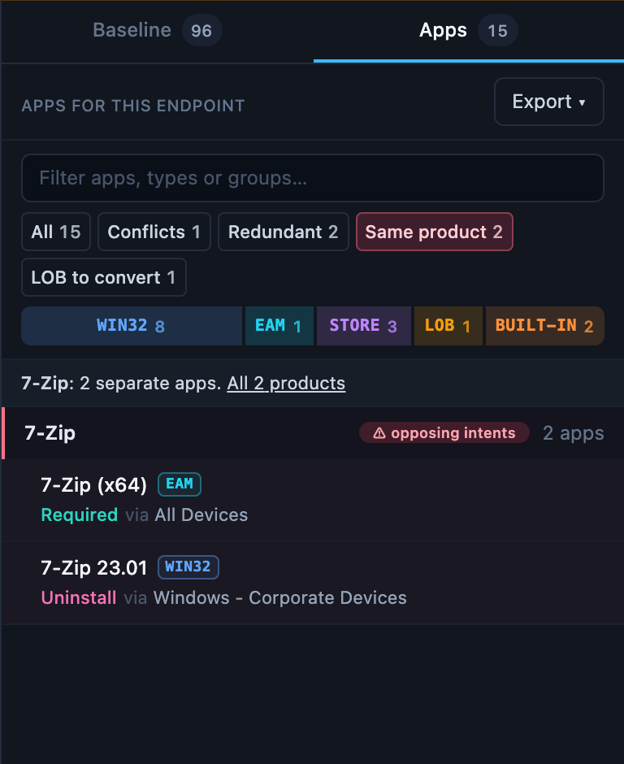

_Clicking "opposing intents" on 7-Zip narrows the list to the two app objects behind it: the catalog app installing for All Devices, and an older Win32 package uninstalling for one group._

A fourth flag is a recommendation rather than a finding about assignments:

- **Line-of-business `.msi` — convert to Win32.** A Windows LOB app uploaded as an `.msi` is tagged in amber. Microsoft recommends [deploying Windows apps as Win32 apps exclusively](https://learn.microsoft.com/intune/app-management/deployment/win32): repackaged as an `.intunewin`, the same installer gains detection rules, requirements, dependencies and supersedence. When the endpoint gets LOB `.msi` apps *and* Win32 apps together, the view says so, because that is the combination Microsoft warns about — both install through TrustedInstaller, one at a time, and during classic Windows Autopilot the [Enrollment Status Page can fail](https://learn.microsoft.com/intune/device-enrollment/windows/setup-status-page#esp-tracking). Windows Autopilot device preparation supports the mix. MSIX/AppX line-of-business apps are not flagged; the advice is about `.msi`.

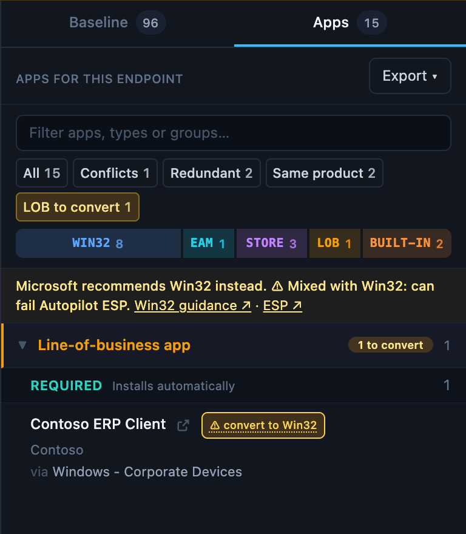

_A line-of-business `.msi` flagged for conversion, with the Enrollment Status Page warning because this endpoint also gets Win32 apps._

> **ℹ️ How far each finding goes.**
> - **A conflict is flagged, not resolved.** Intune settles it by a [documented table](https://learn.microsoft.com/intune/intune-service/apps/apps-deploy#how-conflicts-between-app-intents-are-resolved): Required always beats Uninstall, but *Available* against *Uninstall* depends on whether each group holds users or devices, which this tool cannot see. Every assignment is listed and no winner is picked. The fix is an exclusion — and exclusions only take precedence between groups of the same kind (user with user, device with device).
> - **Redundant is not broken.** Required with Available is a supported combination that Intune treats as "Required and Available"; the Available assignment isn't needed to deliver the app and only keeps it listed in Company Portal. Keep it if you want that.
> - **Same product is a name match.** Intune compares assignments within one app object and never across two, so it reports nothing here however they are assigned — which is why this is worth surfacing, and also why it can only be a heuristic. Names are compared after dropping versions, architecture and packaging words; a package whose whole job is to remove something will pair with the thing it removes, often deliberately. Read it as "verify".
> - **Available is mostly a user-group assignment.** For almost every app type, Intune only honours *Available* when it targets a user group (Win32 apps, and Android Enterprise fully managed / corporate-owned work profile devices, are the exceptions). An available app is listed when a selected group or **All Users** delivers it; since no specific user is modelled, confirm the signed-in user is actually in that group.
> - **Exclusions count against their own intent.** A group excluded from an app's Required assignment is not thereby excluded from its Available one, matching how the admin center records it.
>
> Not covered: Win32 dependencies and supersedence (which can also install or remove an app nobody assigned), app protection (MAM) and app configuration policies, and install status.

**Export** offers an Excel workbook or a CSV. Each app's row carries its own **detection rule** as configured in Intune — the file, registry key or MSI product code Intune checks to decide the app is installed, with every rule listed when there are several. A custom detection script is named as one and its content is left out; a Store app shows its package id. The workbook also carries a **Finding definitions** sheet, stating for every finding exactly what is tested, what it means, what to do and the Microsoft reference — the same definitions the alerts show on hover, so a flag in a spreadsheet can be checked rather than taken on trust.

The Apps view needs one more read-only permission, `DeviceManagementApps.Read.All`, which [SETUP.md](SETUP.md) has you grant with the others. If it is missing, the Apps tab is marked **Needs setup** and names it; the baseline still loads.

## Platform support

Windows, macOS, iOS/iPadOS, and Android are scoped separately, so a Windows simulation never gets cluttered with macOS compliance policies.

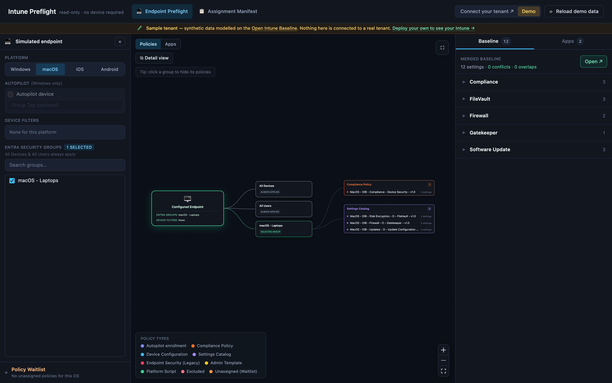

_Switch platform with the four buttons at the top of the sidebar to scope the whole simulation — groups, policies, apps, filters and the waitlist all follow._

| Platform | Baseline | Conflicts & overlaps | Apps |
|---|---|---|---|
| Windows | ✅ | ✅ | ✅ with every finding |
| macOS | ✅ | Suppressed (see above) | ✅ |
| iOS / iPadOS | ✅ | Suppressed | ✅ |
| Android | ✅ | Suppressed | ✅ |

> **Roadmap:** enrollment profiles, and Android policy-type breakdown, are longer-term items — see [ROADMAP.md](../ROADMAP.md).

---

# Assignment Manifest

The simulator answers *"what would this one device get?"* The Manifest answers the tenant-wide question: **which groups carry which policies, and what does a member of each group actually receive?**

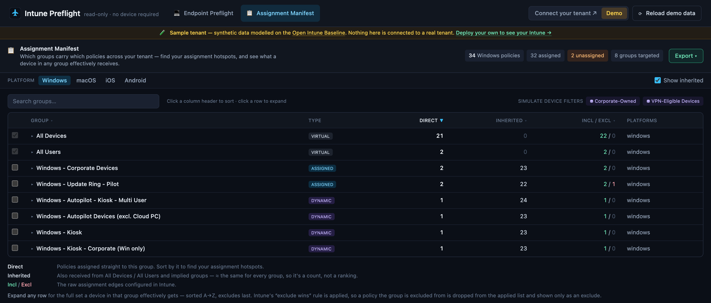

_Every policy → group assignment across the tenant, per platform. Sort by Direct to find your assignment hotspots._

## Purpose

Use it to understand your **policy sets and mappings for every configured Entra group** — where configuration is concentrated, which groups are doing the heavy lifting, and what a device in any given group effectively ends up with.

## Per-group columns

| Column | Meaning |
|---|---|
| **Direct** | Policies assigned straight to this group. The real per-group differentiator — **sort by it to find your assignment hotspots.** |
| **Inherited** | What the group also receives from All Devices / All Users and implied memberships. Roughly constant across groups (it's the tenant-wide baseline), so it's a plain count rather than something to rank by. |
| **Incl / Excl** | The raw assignment edges configured in Intune, before exclude-wins is applied. Sort by it to find the groups carved out of the most policies. |

Every column header sorts; the default is **Direct, descending**.

## Expanding a group

Click any row to see the full set a member of that group effectively receives — sorted A→Z with excludes last.

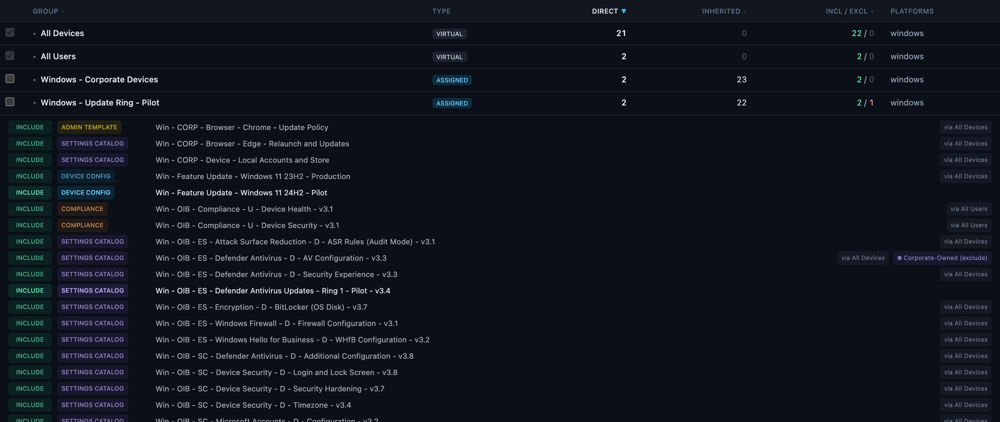

_The effective policy set for one group: direct assignments, inherited policies tagged with their source, and excludes at the bottom._

- Inherited policies are tagged **"via All Devices"** / **"via <group>"**, and implied ones are flagged as such.
- Intune's **exclude-wins** rule is applied: a policy the group is excluded from is dropped from the applied list and shown only as an exclude, so it's clear *why* it doesn't apply.

## All Devices / All Users inheritance

Every group inherits the All Devices and All Users assignments. The Manifest counts them explicitly in the **Inherited** column and lists them in the expanded detail — so the tenant-wide baseline is visible rather than assumed. A **Show inherited** toggle turns it off if you want to see direct assignments only.

## Assignment filter simulation

Click any **⛃ filter chip** — or use the **Simulate device filters** toggles in the toolbar — to treat the device as matching that filter. Because filter membership is a property of the *device*, the toggle is global: **every group recomputes at once.**

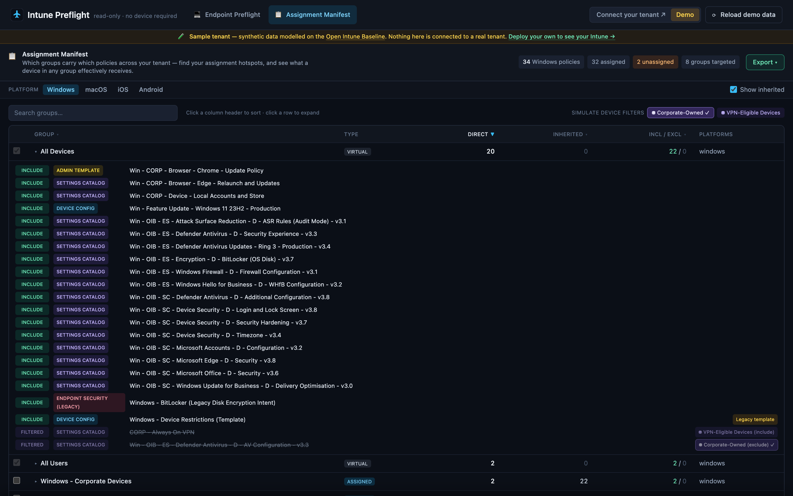

_Toggle a filter and watch the whole tenant re-resolve. Policies the filter drops move to a struck-through "Filtered" line with the reason._

This is the fastest way to answer *"what does my Kiosk filter actually do to my policy set?"* — a question that's genuinely painful to work out in the Intune console.

## Send groups to the simulator

The Manifest and the simulator are two lenses on the same data, so they connect. Tick the checkbox on one or more groups and a bar rises from the bottom: **"Simulate a device in these groups →"**. It drops you into Endpoint Preflight seeded with exactly those groups — plus any device filters you were simulating here — on the Manifest's current OS, recomputing the full merged baseline from scratch. You go from *"which groups look interesting"* to *"what a device in them actually gets"* in one click. (All Devices / All Users always apply, so they're marked *always applies* rather than something you select.)

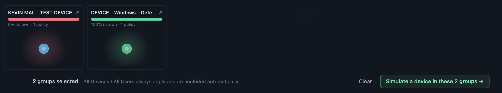

_Check groups in the Manifest, then simulate a device in exactly those groups._

## Per-group policy "seating charts"

As you check groups, a strip above the bar shows each one as a small bubble cluster — a preflight seating check. Every bubble is a policy the group carries, colored by **how shared it is: cool = unique to this group, hot = carried by many groups (bleed)** — with a distinct indigo ⚠ flag for anything scoped to All Devices / All Users *and* a direct group (an assignment Intune's portal normally disallows). A containment bar reads **"68% its own"** at a glance.

Click a chart to open the full **named policy list**: heat-colored chips, unique policies first, and clicking any policy names exactly which other groups carry it. It answers, in one motion, whether a group is its own tidy container or quietly overcrowded with policies borrowed from everywhere — the shared-use view, with no guesswork.

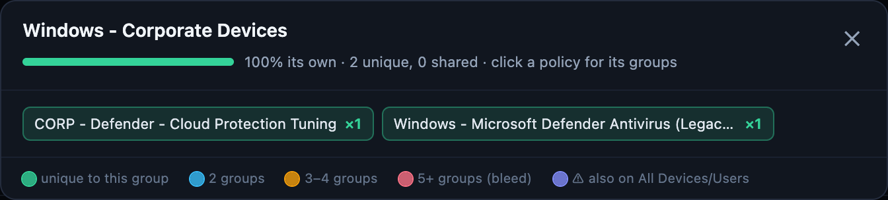

_Each checked group's policies as a heat cluster; click through to the named chip list and see which groups share each policy._

## Export

Download the full manifest from the **Export ▾** menu, as an Excel workbook (`.xlsx`) or CSV — the raw per-assignment detail, ready to pivot by Group or Policy.

The workbook is there because mobile Excel will not open a `.csv` at all, however correct the file is: it has no Text Import wizard, so it declines a format whose delimiter, encoding and column types have to be inferred. (Confirmed on Excel for iPadOS, where a file that opens cleanly in Excel on Windows and macOS is refused as corrupt.) An `.xlsx` declares all three. It also means values like `=SUM(A1)` and `2026-10-28` arrive as the text they are, with none of the quote-prefixing a CSV needs to stay safe.

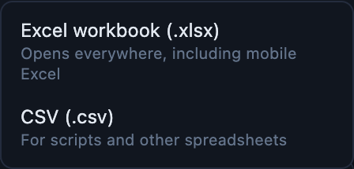

_Export of every policy → group assignment for the selected platform._

> **Shared use is now visible** through the per-group seating charts above — where the *same policy* is assigned across multiple Entra groups. Surfacing group *pairs* whose combined assignment produces conflicts is parked under *Under consideration* in [ROADMAP.md](../ROADMAP.md).

---

## Built for real tenants

A few things that matter once you point this at a production-sized tenant:

- **Fast on large tenants.** Assignments are pulled inline with each collection and per-policy detail calls run with bounded concurrency — a 140-policy tenant loads in seconds.
- **Resilient to flaky Graph.** Throttling (429) and transient gateway errors (502/503/504) are retried with backoff, and every request has a timeout so one wedged connection can't stall a load.
- **Never silently incomplete.** If anything fails to import after retries, the app shows a clear **"Incomplete load"** banner naming what dropped, and the server logs a summary. A partial baseline is never presented as a complete one.
- **Refresh on demand.** An in-memory cache keeps things fast; **Refresh from Intune** clears it and re-reads the tenant after you make changes in the admin center.
